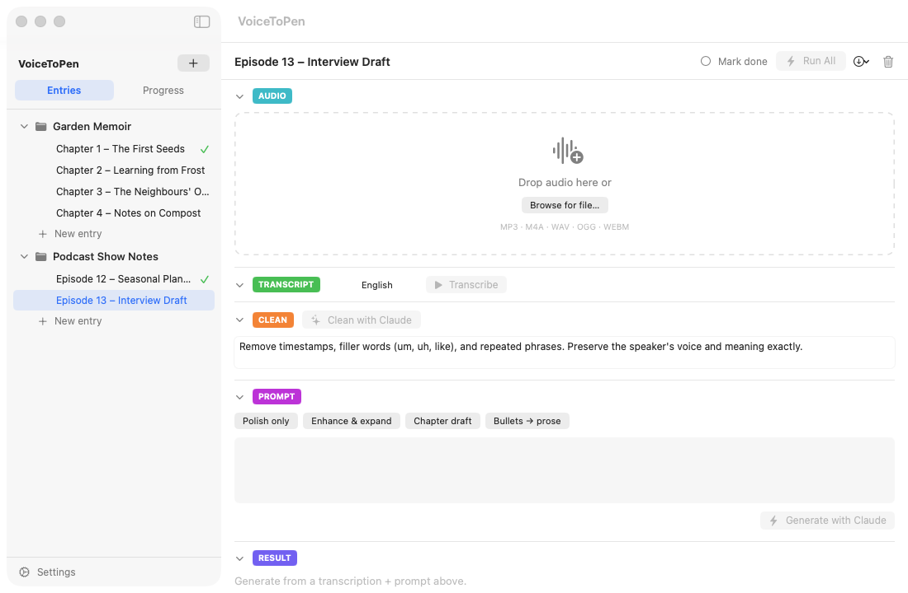

# 2. Quick Start: From Audio to Polished Text

This walkthrough takes you from a recording to finished text in a few minutes. It assumes you've already entered your API keys ([Getting Started](01-getting-started.md)).

You'll need an audio file to start with — for example, a voice memo recorded with the **Voice Memos** app on your iPhone or Mac. VoiceToPen accepts **MP3, M4A, WAV, OGG and WEBM** files.

> VoiceToPen has no recording feature, by design. It's made for an organized workflow: you record whenever and wherever it suits you, and transcribe and work on the recordings later — days or weeks later if you like.

## 1. Create a project

1. In the sidebar, click the **+** button next to "VoiceToPen".
2. Type a name (for example, "My Book") and click **Create**.

## 2. Create an entry

An *entry* is one recording and everything made from it.

1. Click **New entry** under your project (or press **⌘N**).
2. Click the title "New Entry" at the top of the main area, type a better name, and press **Return**.

## 3. Add your audio

Drag your audio file onto the dashed **AUDIO** box — or click **Browse for file…** and choose it. You'll see the file name, its size, and a player so you can listen.

## 4. Pick a prompt

In the **PROMPT** section, click one of the ready-made prompts to start with:

- **Polish only** — light cleanup, keeps your voice
- **Enhance & expand** — turns it into well-structured prose
- **Chapter draft** — shapes it into a book chapter
- **Bullets → prose** — turns bullet points into flowing text

You can edit the text of the prompt or write your own.

## 5. Click Run All

Click **Run All** (the lightning bolt) at the top right. VoiceToPen will:

1. **Transcribe** your audio with ElevenLabs
2. **Clean** the transcript with Claude (removing "um", "uh", repeats and timestamps)
3. **Generate** your final text with Claude, following your prompt

A bar at the top shows the progress of each step. Long recordings can take a few minutes.

## 6. Use your result

Your finished text appears in the **RESULT** section. From there you can:

- Click the **copy** icon to copy it to the clipboard
- Switch to **Source** to edit the text directly
- Click the **window** icon to open it in its own large window
- Use the **Export** menu (the ↓ icon at the top) and choose **Export Result…** to save it as a Markdown file

When you're happy with an entry, click **Mark done** at the top so you can track your progress.

**Next:** [Projects & Entries →](03-projects-and-entries.md) · Learn each step in detail in [The Writing Workflow](04-workflow-stages.md).
