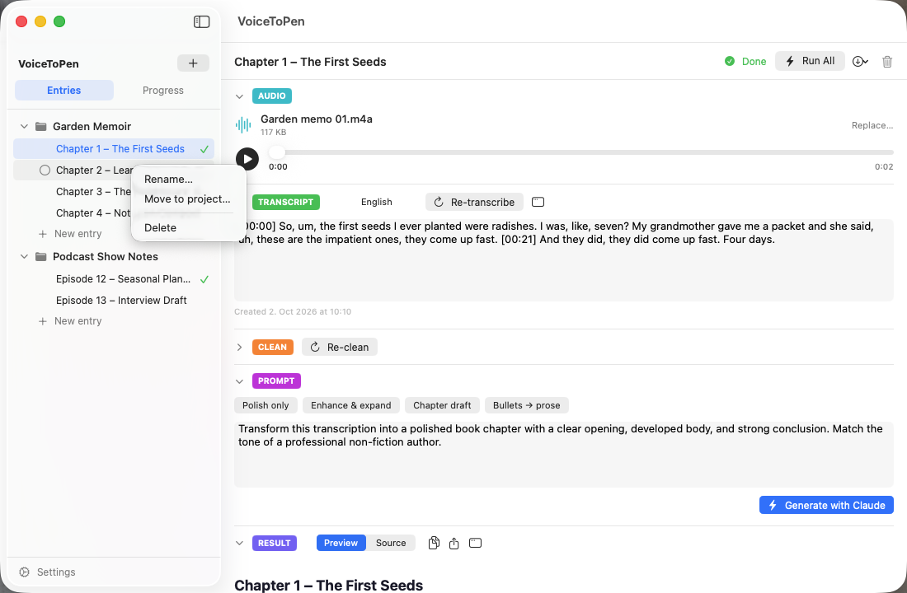
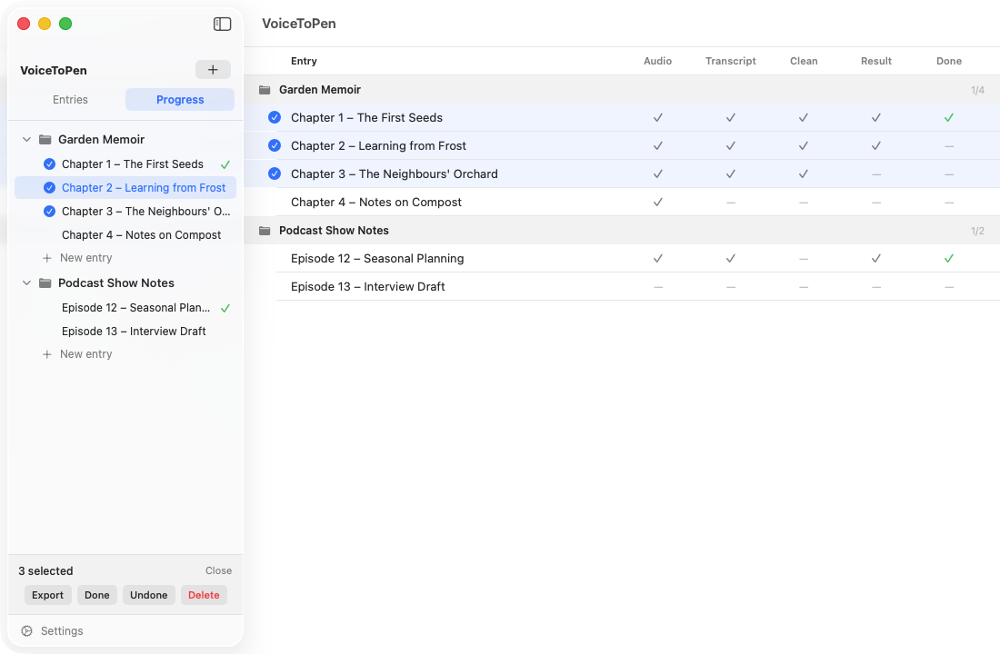

# 3. Projects & Entries

VoiceToPen organizes your work in two levels:

- A **project** is a container — a book, a series of articles, a course.
- An **entry** is one recording inside a project, together with its transcript, cleaned text, prompt and result. Think of it as one chapter or one section.

Projects and their entries are listed in the sidebar. Click the arrow next to a project to show or hide its entries.

## Projects

### Create a project

1. Click the **+** button at the top of the sidebar.
2. Enter a name and click **Create** (or press **Return**).

### Rename, export or delete a project

Right-click (or Control-click) a project in the sidebar:

| Menu item | What it does |
|---|---|
| **Rename…** | Change the project's name |
| **Mark all done** | Mark every entry in the project as done |
| **Export project…** | Save the whole project as one file — see [Exporting Your Work](06-exporting.md) |
| **Delete** | Delete the project **and all its entries** |

> **Tip:** Hover over a project to see how many of its entries are done, for example "3/8".

> ⚠️ **Deleting is permanent.** A deleted project or entry does not go to the Trash and cannot be restored. Export anything you want to keep first.

## Entries

### Create an entry

Do one of the following:

- Click **New entry** under an expanded project.
- Choose **Entry → New Entry** from the menu bar, or press **⌘N**. The entry is added to the project you're currently working in.

New entries are called "New Entry" until you rename them.

### Open an entry

Click it in the sidebar. The entry opens in the main area.

### Rename an entry

- Click the title at the top of the open entry, type a new name and press **Return**, **or**
- Right-click the entry in the sidebar and choose **Rename…**

### Move an entry to another project

1. Right-click the entry in the sidebar and choose **Move to project…**
2. Click the project you want to move it to.

Everything in the entry — audio, transcript, results — moves with it.

### Mark an entry as done

Click **Mark done** at the top of the open entry. It changes to a green **Done**, and a green checkmark appears next to the entry in the sidebar. Click again to undo.

"Done" is just a marker for your own tracking. It doesn't lock or change the entry.

### Delete an entry

- Click the **trash** icon at the top right of the open entry, **or**
- Right-click the entry in the sidebar and choose **Delete**.

Confirm by clicking **Delete**.

## Working with several entries at once

You can select several entries — even from different projects — and act on them together.

1. Hover over an entry in the sidebar (or a row in the [Progress view](05-progress-view.md)). A small circle appears to the left of its name.
2. Click the circle to select the entry. Repeat for others.
3. A bar appears at the bottom of the sidebar showing how many are selected, with these buttons:

| Button | What it does |
|---|---|
| **Export** | Export the selected entries into one file — see [Exporting Your Work](06-exporting.md) |
| **Done** / **Undone** | Mark all selected entries as done or not done |
| **Delete** | Delete all selected entries |
| **Close** | Clear the selection |

> ⚠️ **Bulk Delete does not ask for confirmation.** The selected entries are deleted immediately and permanently. Double-check your selection first.

## Saving

There is no Save button: every change you make — titles, edits to text, done status — is saved automatically as you go.

**Next:** [The Writing Workflow →](04-workflow-stages.md)
