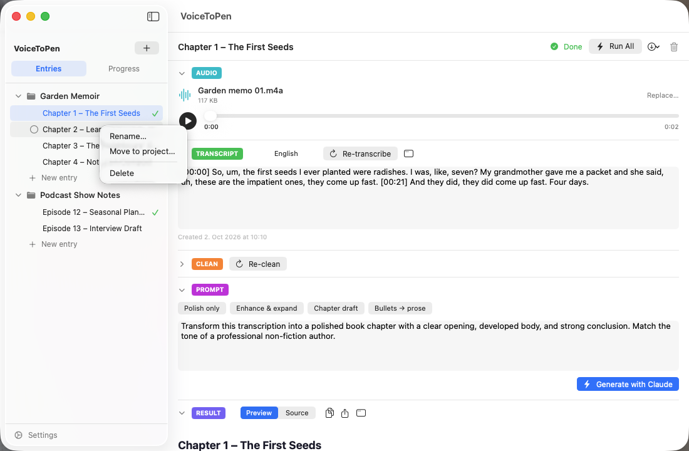
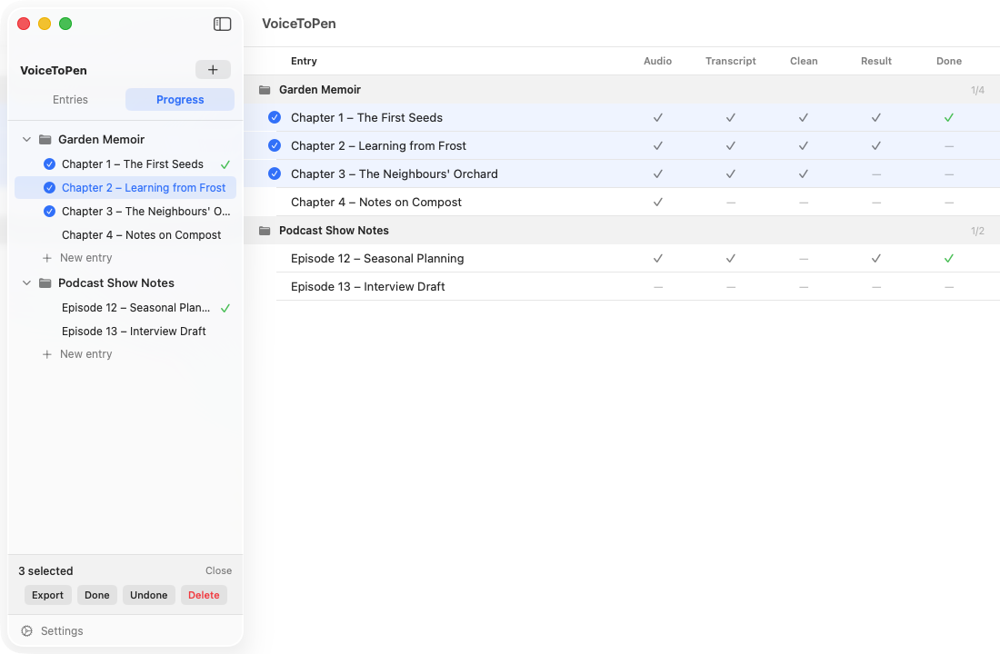

# 3. Projects & Entries

VoiceToPen organizes your work in two levels:

- A **project** is a container — a book, a series of articles, a course.
- An **entry** is one recording inside a project, together with its transcript, cleaned text, prompt and result. Think of it as one chapter or one section.

Projects and their entries are listed in the sidebar. Click the arrow next to a project to show or hide its entries.

## Projects

### Create a project

1. Click the **+** button at the top of the sidebar.
2. Enter a name and click **Create** (or press **Return**).

### Rename, export or delete a project

Right-click (or Control-click) a project in the sidebar. On iPad, touch and hold it.

| Menu item | What it does |
|---|---|
| **Rename…** | Change the project's name |
| **Mark all done** | Mark every entry in the project as done |
| **Export project…** | Save the whole project as one file — see [Exporting Your Work](06-exporting.md) |
| **Delete** | Delete the project **and all its entries** |

> **Tip:** Hover over a project to see how many of its entries are done, for example "3/8". On iPad, the count is always shown.

> ⚠️ **Deleting is permanent.** A deleted project or entry does not go to the Trash and cannot be restored. Export anything you want to keep first.

## Entries

### Create an entry

Do one of the following:

- Click **New entry** under an expanded project.
- Choose **Entry → New Entry** from the menu bar, or press **⌘N**. The entry is added to the project you're currently working in.

New entries are called "New Entry" until you rename them.

### Open an entry

Click it in the sidebar. The entry opens in the main area.

### Rename an entry

- Click the title at the top of the open entry, type a new name and press **Return**, **or**
- Right-click the entry in the sidebar and choose **Rename…**

> **On iPad:** Wherever this guide says right-click, touch and hold the project or entry instead. The same menu opens.

### Move an entry to another project

- **Drag** the entry in the sidebar onto another project's name, **or**
- Right-click the entry in the sidebar, choose **Move to project…** and click the project you want to move it to.

Everything in the entry — audio, transcript, results — moves with it.

> **On iPad:** touch and hold the entry and start moving your finger right away to drag it.

### Recordings from Voice Memos

VoiceToPen adds itself to the **Share** menu of other apps. This is a *share extension*: it comes with the app, so there's nothing extra to download or buy. With it you can send a recording to VoiceToPen without leaving **Voice Memos**.

1. In Voice Memos, select the recording and choose **Share → VoiceToPen**.
2. That's it — you stay in Voice Memos and nothing else opens. Share as many recordings as you like.
3. Open VoiceToPen (or switch back to it). Each shared recording is now a **new entry** in a separate project called **From Voice Memos**, named after the recording, with its audio already added. VoiceToPen creates this project the first time and adds to it after that. A short message shows how many recordings arrived.
4. **Drag** each entry from **From Voice Memos** onto the project it belongs to — see [Move an entry to another project](#move-an-entry-to-another-project). **Move to project…** works too.

This also works from other apps that can share audio files, such as **Files**. Those recordings also go to **From Voice Memos**.

#### If VoiceToPen isn't in the Share menu

**On iPad:** in the Share menu, scroll the row of app icons to the end and tap **More**. Find **VoiceToPen** in the list. Tap **Edit** and add it to your **Favorites** so it shows near the front next time.

**On the Mac:** macOS sometimes leaves new share extensions switched off. Choose **Share → Edit Extensions…** (at the bottom of the Share menu) and turn on **VoiceToPen**. You can also find this in **System Settings** by searching for "Extensions".

### Mark an entry as done

Click **Mark done** at the top of the open entry. It changes to a green **Done**, and a green checkmark appears next to the entry in the sidebar. Click again to undo.

"Done" is just a marker for your own tracking. It doesn't lock or change the entry.

### Delete an entry

- Click the **trash** icon at the top right of the open entry, **or**
- Right-click the entry in the sidebar and choose **Delete**.

Confirm by clicking **Delete**.

## Working with several entries at once

You can select several entries — even from different projects — and act on them together.

1. Hover over an entry in the sidebar (or a row in the [Progress view](05-progress-view.md)). A small circle appears to the left of its name.
2. Click the circle to select the entry. Repeat for others.

    On iPad, tap **Select** at the top of the sidebar first. Circles appear next to every entry; tap entries to select them. Tap **Done** at the top when you're finished.

3. A bar appears at the bottom of the sidebar showing how many are selected, with these buttons:

| Button | What it does |
|---|---|
| **Export** | Export the selected entries into one file — see [Exporting Your Work](06-exporting.md) |
| **Done** / **Undone** | Mark all selected entries as done or not done |
| **Delete** | Delete all selected entries |
| **Close** | Clear the selection |

When you click **Delete**, VoiceToPen asks you to confirm (for example, "Delete 3 entries?"). Click **Delete** to go ahead or **Cancel** to keep them.

> ⚠️ Deleted entries cannot be restored, so double-check your selection before confirming.

## Saving

There is no Save button: every change you make — titles, edits to text, done status — is saved automatically as you go.

**Next:** [The Writing Workflow →](04-workflow-stages.md)
