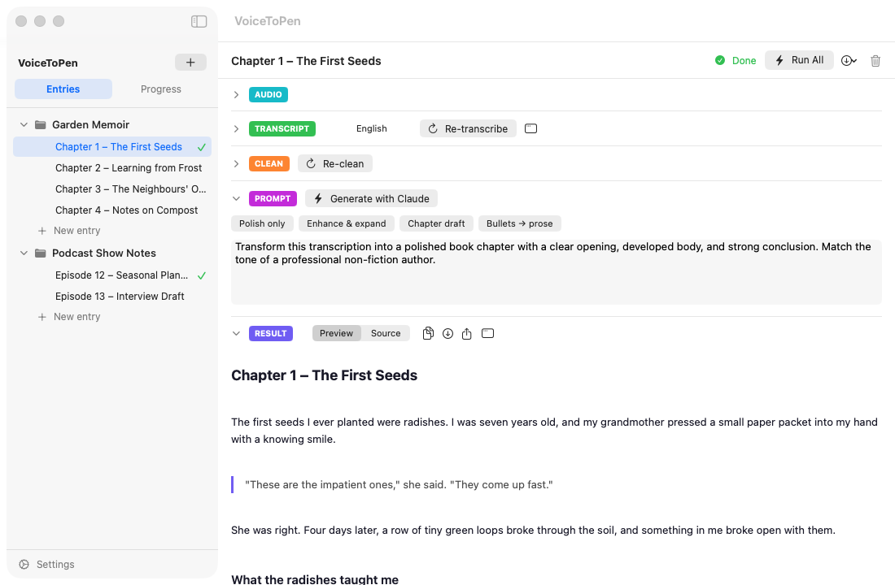
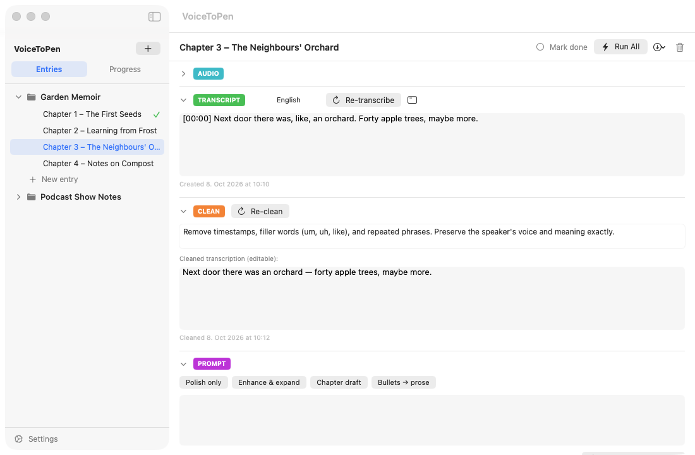
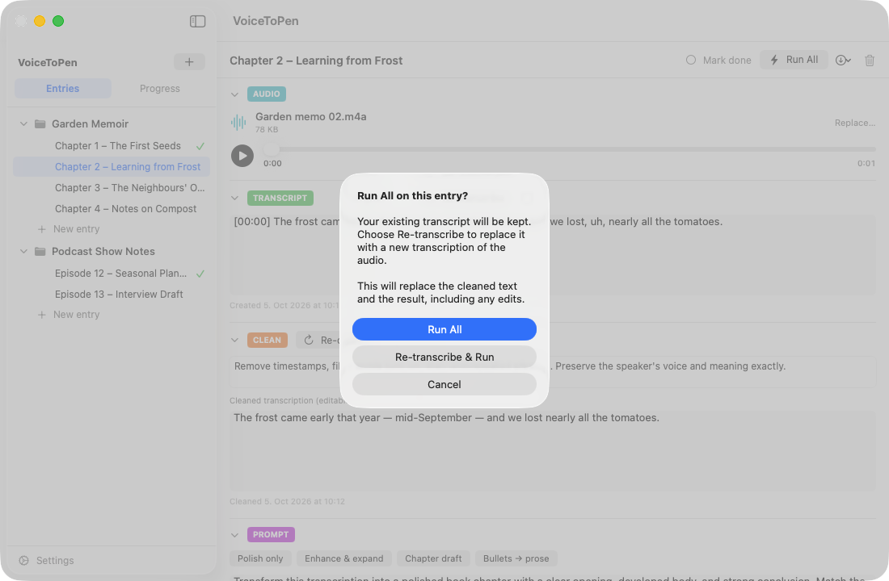

# 4. The Writing Workflow

Each entry moves through five stages, shown as sections from top to bottom:

**AUDIO → TRANSCRIPT → CLEAN → PROMPT → RESULT**

Click a section's colored label to collapse or expand it. You can run each stage step by step, or run them all at once with **Run All**.

---

## AUDIO

This is where your recording goes.

**To add audio**, drag a file onto the dashed box, or click **Browse for file…**. Supported formats: **MP3, M4A, WAV, OGG, WEBM**. On iPad, the file comes from the Files app — see [Using VoiceToPen on iPad](10-ipad.md). Recordings you send from Voice Memos with **Share → VoiceToPen** arrive with their audio already added — see [Recordings from Voice Memos](03-projects-and-entries.md#recordings-from-voice-memos).

Once added, you'll see the file name, its size and a player. Click ▶ to listen; drag the slider to jump around.

**To use a different recording**, click **Replace…** and confirm with **Remove Recording**. The current recording is removed from the entry, and you can add a file or record a new one. Any existing transcript and results are kept until you transcribe again.

VoiceToPen keeps its own copy of the file, so you can move or delete the original afterwards.

### Recording in VoiceToPen

You can also record straight into an entry that doesn't have audio yet:

1. Click **Record** next to **Browse for file…**. The first time, your Mac or iPad asks whether VoiceToPen may use the microphone — choose **Allow**.
2. Speak. A red dot and a timer show that VoiceToPen is recording.
3. Click **Stop**. The recording is saved in the entry — named with the date and time, for example "Recording 28 Oct 2026 at 10.42" — and you can play it, transcribe it or use **Run All** as with any other audio. Click **Cancel** instead to throw it away.

Only one recording runs at a time. If you open another entry while recording, the recording keeps going and is saved in the entry where you started it.

> **On iPad:** keep VoiceToPen on screen while you record. If you switch to another app or lock the iPad, the recording stops and what you've recorded so far is saved.

> **Microphone access:** if you chose **Don't Allow** earlier, turn it on in **System Settings → Privacy & Security → Microphone** on the Mac, or **Settings → Privacy & Security → Microphone** on iPad.

---

## TRANSCRIPT

Turns your audio into text using ElevenLabs.

1. Choose the **language** spoken in the recording from the menu (it starts at your **Default Language** from Settings). Choose **Auto** to let ElevenLabs detect it.
2. Click **Transcribe**.

When it's done, the transcript appears in an editable box. You can fix names, spelling, or anything the transcription got wrong — your edits are saved automatically.

Click the **window** icon next to the button to open the transcript in its own large, resizable window. Edits there are saved too.

While VoiceToPen is transcribing, cleaning, generating or running **Run All**, the transcript and the cleaned text can't be edited — the box shows "editing is paused" until the step is done. That way the text being processed is always the text you see.

**Re-transcribe** runs the transcription again (for example, after replacing the audio or choosing a different language).

> ⚠️ Re-transcribing **replaces** the transcript, including any edits you made to it. VoiceToPen asks before it does.

**Your edits and the original.** VoiceToPen keeps the transcript exactly as it came from ElevenLabs. Once you've edited the transcript, an **Edited | Original** switch appears next to the buttons: choose **Original** to see the unedited version (read-only). While it's showing, **Restore Original…** throws away your edits and brings the original back, after asking you. The switch appears for transcripts made with version 1.1 or later.

**Supported languages in the menu:** Auto, English, German, French, Spanish, Italian, Portuguese, Dutch, Polish, Russian, Chinese, Japanese, Korean, Arabic, Hindi, Turkish.

---

## CLEAN

*Optional.* Uses Claude to tidy the raw transcript before rewriting it. This section is collapsed by default — click **CLEAN** to open it.

1. Check the **cleaning instructions**. The default is:
   > Remove timestamps, filler words (um, uh, like), and repeated phrases. Preserve the speaker's voice and meaning exactly.

   Change them if you like — for example, "Also fix obvious grammar mistakes" or "Keep the timestamps". **Run All** uses these same instructions.
2. Click **Clean with Claude**.

The cleaned text appears as it's being written. When it's done, you can edit it in the box below **Cleaned transcription (editable)**.

As with the transcript, VoiceToPen keeps Claude's original cleaned text: after you edit it, use the **Edited | Original** switch to look at the original or **Restore Original…** to go back to it. **Re-clean** asks before it replaces your cleaned text.

**Re-clean** runs it again with the current instructions.

> ⚠️ Re-cleaning **replaces** the cleaned text, including any edits you made to it. VoiceToPen asks before it does.

**Why clean first?** When an entry has a cleaned version, the next stage uses *that* instead of the raw transcript. A cleaner input usually gives a better result.

> **Note:** If you edit the raw transcript *after* cleaning, click **Re-clean** so your changes reach the cleaned text — otherwise Generate will keep using the older cleaned version.

---

## PROMPT

Tells Claude what to write.

Click a ready-made prompt to fill in the box, then adjust it if you like:

| Button | What you get |
|---|---|
| **Polish only** | Light polishing for clarity and flow; your voice stays intact |
| **Enhance & expand** | Well-structured, engaging prose with transitions |
| **Chapter draft** | A polished book chapter with opening, body and conclusion |
| **Bullets → prose** | Bullet points turned into flowing text |

Or write your own, for example:

- "Turn this into a 600-word blog post with a catchy title and subheadings."
- "Summarize the key ideas as a bulleted list."
- "Rewrite this as a friendly newsletter to my readers."

Then click **Generate with Claude**.

> **Tip:** Your prompt is saved with the entry automatically as you type, so it's still there when you switch to another entry and come back.

---

## RESULT

Shows the text Claude wrote. While it's being generated, you can watch it appear.

| Control | What it does |
|---|---|
| **Preview** | Shows the text nicely formatted (headings, lists, bold, etc.) |
| **Source** | Shows the plain Markdown text so you can edit it — edits are saved automatically |
| **Copy** icon | Copies the result to the clipboard as Markdown — best for writing apps that understand Markdown |
| **Export** icon (↓ in a circle) | Saves the result as a Markdown (`.md`) file, like **Export Result…** in the entry's **Export** menu — see [Exporting Your Work](06-exporting.md) |
| **Share** icon | Opens the share menu so you can send the result to Mail, Messages, Notes, AirDrop or another app. It sends **plain text**: headings without `#`, no `**` around bold words, bullets as "•" — so posts look clean in social and messaging apps |
| **Window** icon | Opens the result in its own large window (which also has **Copy** and **Share**) |

Below the text you'll see when it was generated.

To try a different version, change the prompt and click **Generate with Claude** again.

> ⚠️ Generating again **replaces** the current result, including your edits. Copy or export a version you like before trying another.

### Sharing your result

Click the **Share** icon in the **RESULT** section (or in the full-text window) to send the finished text to another app. The Share menu lists the apps on your device that accept text.

- **On iPad:** writing, notes, messaging, social and publishing apps, plus **Save to Files**.
- **On the Mac:** Mail, Messages, Notes, AirDrop and other Mac apps that accept text.

If an app you expect isn't in the Share menu, scroll to the end of the row of app icons and tap **More**.

### Post to social networks

On iPad, you can post a result straight to these apps, if they're installed:

| App | Where the text goes |
|---|---|
| **Substack** | A new **Note** |
| **Threads** | A new post |
| **LinkedIn** | A new post |
| **Bluesky** | A new post |
| **Mastodon** | A new post |

1. Open the entry and check the result in the **RESULT** section.
2. Tap the **Share** icon and choose the app.
3. The text arrives in that app, ready to edit and post.

That's the whole path from a voice memo to a published post, without leaving your iPad.

> **Facebook, Instagram and Medium:** these apps don't accept text shared from other apps as a new post, so they either don't show up in the Share menu or don't take the text. Tap the **Copy** icon instead, then paste the text into a new post in the app.

---

## Run All

The **Run All** button at the top of the entry runs Transcribe → Clean → Generate in one go. A progress bar shows each step.

Before you click it:

- The entry must have **audio**.
- The **PROMPT** box must contain a prompt.

How it behaves:

- If the entry has **no transcript** yet, it transcribes the audio using the language currently selected in the **TRANSCRIPT** section.
- If the entry **already has a transcript**, it keeps it (including your edits) and starts from cleaning.
- For cleaning, it uses the instructions currently in the **CLEAN** section's box. If that box is empty, cleaning is skipped.
- If transcription fails, it stops and shows "Pipeline failed".

If the entry already has a transcript, cleaned text or result, VoiceToPen asks before running:

| Button | What happens |
|---|---|
| **Run All** | Keeps the existing transcript, then cleans and generates |
| **Re-transcribe & Run** | Transcribes the audio again (replacing the transcript), then cleans and generates |
| **Cancel** | Nothing changes |

> ⚠️ Run All **replaces** the cleaned text and the result, including any edits. The confirmation tells you which of these will be replaced. To keep them, click **Cancel** and run only the stage you need (for example, just **Generate with Claude**).

---

## Long recordings

Very long transcripts (roughly more than 80,000 characters — about an hour or more of speech) are split into parts at paragraph breaks and processed one after another. The parts are joined back together in the final text. This happens automatically.

**Next:** [The Progress View →](05-progress-view.md)
