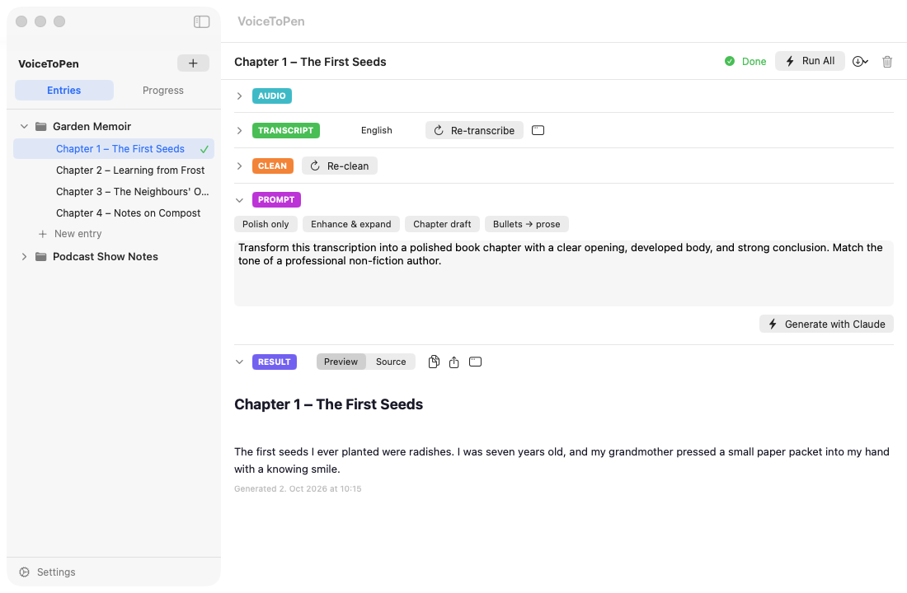
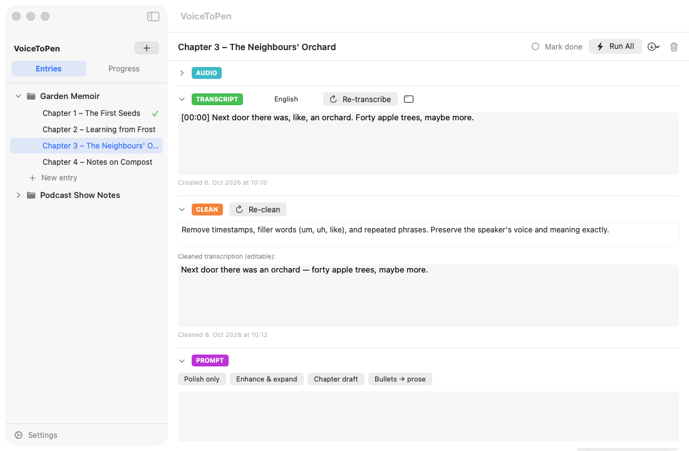
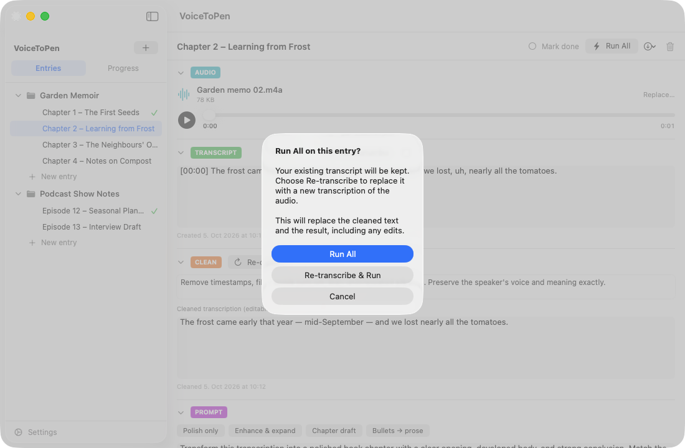

# 4. The Writing Workflow

Each entry moves through five stages, shown as sections from top to bottom:

**AUDIO → TRANSCRIPT → CLEAN → PROMPT → RESULT**

Click a section's colored label to collapse or expand it. You can run each stage step by step, or run them all at once with **Run All**.

---

## AUDIO

This is where your recording goes.

**To add audio**, drag a file onto the dashed box, or click **Browse for file…**. Supported formats: **MP3, M4A, WAV, OGG, WEBM**.

Once added, you'll see the file name, its size and a player. Click ▶ to listen; drag the slider to jump around.

**To use a different recording**, click **Replace…**. Any existing transcript and results are kept until you transcribe again.

VoiceToPen keeps its own copy of the file, so you can move or delete the original afterwards.

---

## TRANSCRIPT

Turns your audio into text using ElevenLabs.

1. Choose the **language** spoken in the recording from the menu (it starts at your **Default Language** from Settings). Choose **Auto** to let ElevenLabs detect it.
2. Click **Transcribe**.

When it's done, the transcript appears in an editable box. You can fix names, spelling, or anything the transcription got wrong — your edits are saved automatically.

Click the **window** icon next to the button to open the transcript in its own large, resizable window. Edits there are saved too.

**Re-transcribe** runs the transcription again (for example, after replacing the audio or choosing a different language).

> ⚠️ Re-transcribing **replaces** the transcript, including any edits you made to it.

**Supported languages in the menu:** Auto, English, German, French, Spanish, Italian, Portuguese, Dutch, Polish, Russian, Chinese, Japanese, Korean, Arabic, Hindi, Turkish.

---

## CLEAN

*Optional.* Uses Claude to tidy the raw transcript before rewriting it. This section is collapsed by default — click **CLEAN** to open it.

1. Check the **cleaning instructions**. The default is:
   > Remove timestamps, filler words (um, uh, like), and repeated phrases. Preserve the speaker's voice and meaning exactly.

   Change them if you like — for example, "Also fix obvious grammar mistakes" or "Keep the timestamps".
2. Click **Clean with Claude**.

The cleaned text appears as it's being written. When it's done, you can edit it in the box below **Cleaned transcription (editable)**.

**Re-clean** runs it again with the current instructions.

> ⚠️ Re-cleaning **replaces** the cleaned text, including any edits you made to it.

**Why clean first?** When an entry has a cleaned version, the next stage uses *that* instead of the raw transcript. A cleaner input usually gives a better result.

> **Note:** If you edit the raw transcript *after* cleaning, click **Re-clean** so your changes reach the cleaned text — otherwise Generate will keep using the older cleaned version.

---

## PROMPT

Tells Claude what to write.

Click a ready-made prompt to fill in the box, then adjust it if you like:

| Button | What you get |
|---|---|
| **Polish only** | Light polishing for clarity and flow; your voice stays intact |
| **Enhance & expand** | Well-structured, engaging prose with transitions |
| **Chapter draft** | A polished book chapter with opening, body and conclusion |
| **Bullets → prose** | Bullet points turned into flowing text |

Or write your own, for example:

- "Turn this into a 600-word blog post with a catchy title and subheadings."
- "Summarize the key ideas as a bulleted list."
- "Rewrite this as a friendly newsletter to my readers."

Then click **Generate with Claude**.

> **Tip:** Your prompt is saved with the entry when you click **Generate with Claude**. If you switch to another entry before generating, an unsent prompt is not kept.

---

## RESULT

Shows the text Claude wrote. While it's being generated, you can watch it appear.

| Control | What it does |
|---|---|
| **Preview** | Shows the text nicely formatted (headings, lists, bold, etc.) |
| **Source** | Shows the plain Markdown text so you can edit it — edits are saved automatically |
| **Copy** icon | Copies the result to the clipboard |
| **Window** icon | Opens the result in its own large window |

Below the text you'll see when it was generated.

To try a different version, change the prompt and click **Generate with Claude** again.

> ⚠️ Generating again **replaces** the current result, including your edits. Copy or export a version you like before trying another.

---

## Run All

The **Run All** button at the top of the entry runs Transcribe → Clean → Generate in one go. A progress bar shows each step.

Before you click it:

- The entry must have **audio**.
- The **PROMPT** box must contain a prompt.

How it behaves:

- It uses the language currently selected in the **TRANSCRIPT** section.
- For cleaning, it uses the instructions from the last time you cleaned this entry — or the default instructions if you never did.
- If transcription fails, it stops and shows "Pipeline failed".

> ⚠️ Run All **always starts from scratch**: it re-transcribes the audio and replaces the transcript, the cleaned text and the result — including any edits. To keep your edits, run only the stage you need (for example, just **Generate with Claude**).

---

## Long recordings

Very long transcripts (roughly more than 80,000 characters — about an hour or more of speech) are split into parts at paragraph breaks and processed one after another. The parts are joined back together in the final text. This happens automatically.

**Next:** [The Progress View →](05-progress-view.md)
