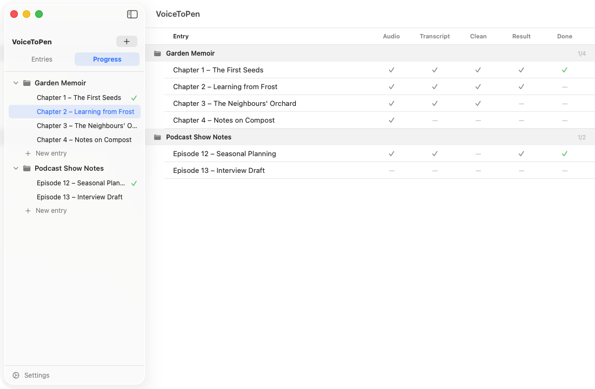

# 5. The Progress View

The Progress view gives you an overview of every entry in every project, so you can see at a glance what's finished and what still needs work.

## Open the Progress view

At the top of the sidebar, click **Progress**. Click **Entries** to go back to the normal view.

## Reading the table

Entries are grouped by project. Each project's header shows how many of its entries are done (for example, "3/8").

Each row is one entry, with these columns:

| Column | A checkmark means… |
|---|---|
| **Audio** | An audio file has been added |
| **Transcript** | The audio has been transcribed |
| **Clean** | The transcript has been cleaned |
| **Result** | A final text has been generated |
| **Done** | You've marked the entry as done (green checkmark) |

A dash (—) means that stage hasn't happened yet.

## Open an entry from the table

**Double-click** a row to open that entry. A **← Progress** link appears at the top left of the entry so you can jump straight back to the table.

## Select entries for bulk actions

Hover over a row and click the circle on the left to select it. Selected entries can be exported, marked done or undone, or deleted from the bar at the bottom of the sidebar — see [Working with several entries at once](03-projects-and-entries.md#working-with-several-entries-at-once).

> **Tip:** The Progress view is a handy place to select entries for a bulk export — for example, every entry that has a result.

**Next:** [Exporting Your Work →](06-exporting.md)
