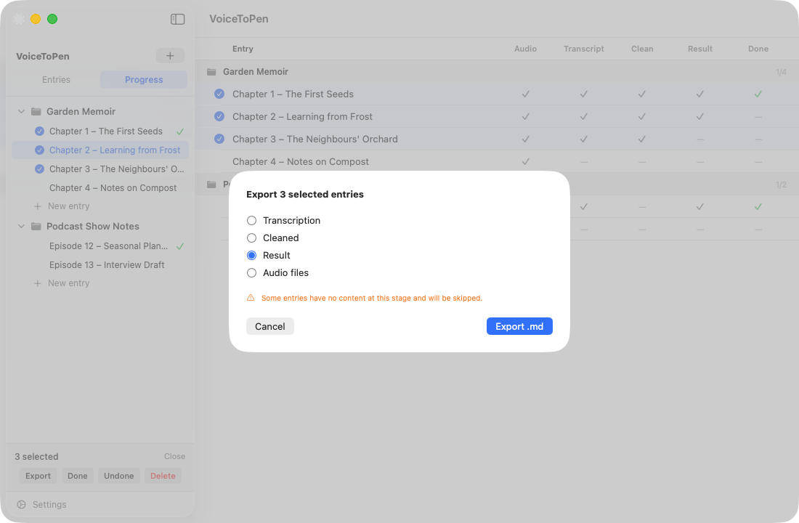

# 6. Exporting Your Work

You can save your text as **Markdown (.md)** files and save copies of your audio. Markdown is plain text with simple formatting marks (like `#` for headings); it opens in any text editor and can be imported into most writing apps, including Ulysses, iA Writer, Obsidian, Notion, Scrivener and Google Docs.

You can export one entry, a whole project, or any selection of entries.

## Export a single entry

1. Open the entry.
2. Click the **Export** icon (↓ in a circle) at the top right.
3. Choose what to export:

| Menu item | Saves |
|---|---|
| **Export Transcript…** | The transcript as a `.md` file |
| **Export Cleaned…** | The cleaned transcript as a `.md` file |
| **Export Result…** | The final text as a `.md` file |
| **Save audio file…** | A copy of the original audio file |

4. Choose where to save and click **Save**.

The exported file starts with the entry's title as a heading.

> **Tip:** To paste the result straight into another app instead, use the **copy** icon in the **RESULT** section.

## Export a whole project

1. In the sidebar, right-click the project and choose **Export project…**
2. Choose a stage: **Transcription**, **Cleaned**, **Result**, or **Audio files**.
3. Click **Export .md** (or **Save audio files…**) and choose where to save.

For text stages, all entries are combined into **one file**, in the order they appear in the sidebar. Each entry starts with its title as a heading, and entries are separated by a horizontal line. This is a quick way to assemble a full manuscript.

## Export selected entries

1. Select entries using the circles in the sidebar or the [Progress view](05-progress-view.md).
2. In the bar at the bottom of the sidebar, click **Export**.
3. Choose a stage and click **Export .md** (or **Save audio files…**).

The selected entries are combined into one file, just like a project export. The order of entries in the file may differ from the sidebar — if order matters, export the whole project instead.

## Notes

- If an entry has nothing at the stage you chose (for example, no result yet), it still appears in the combined file under its title, with the placeholder *(no content)*. The export window warns you when this applies.
- **Audio files** are saved as separate files into a folder you choose, using their original file names. A file in that folder with the same name is **replaced**.
- Exports are copies. Changing an exported file doesn't change anything in VoiceToPen, and vice versa.

**Next:** [Privacy & Your Data →](07-privacy-and-data.md)
