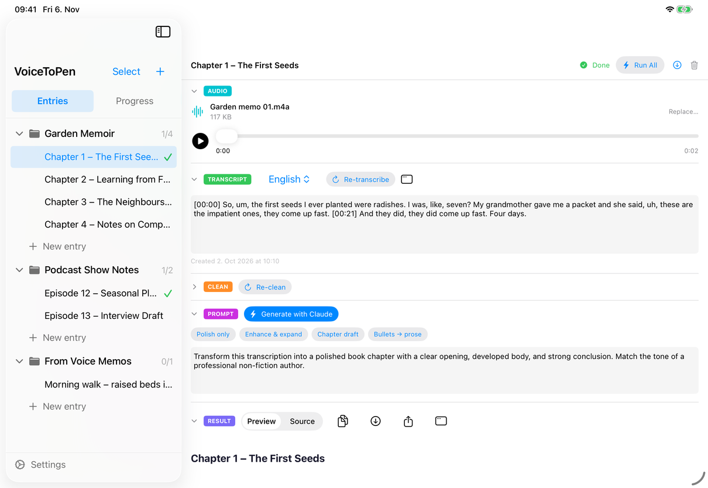
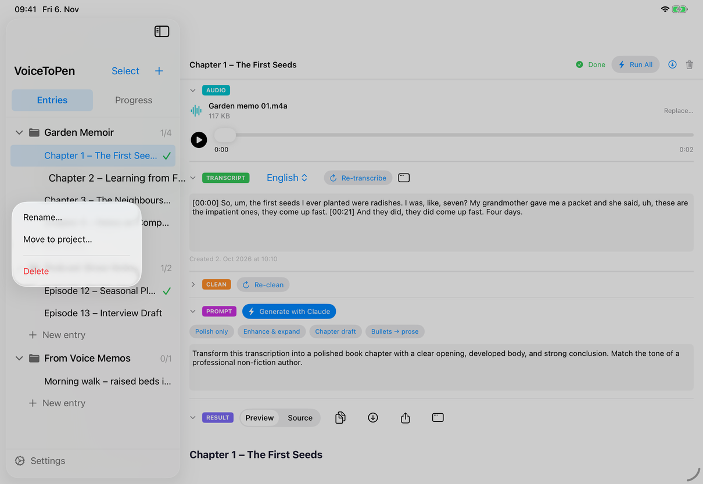
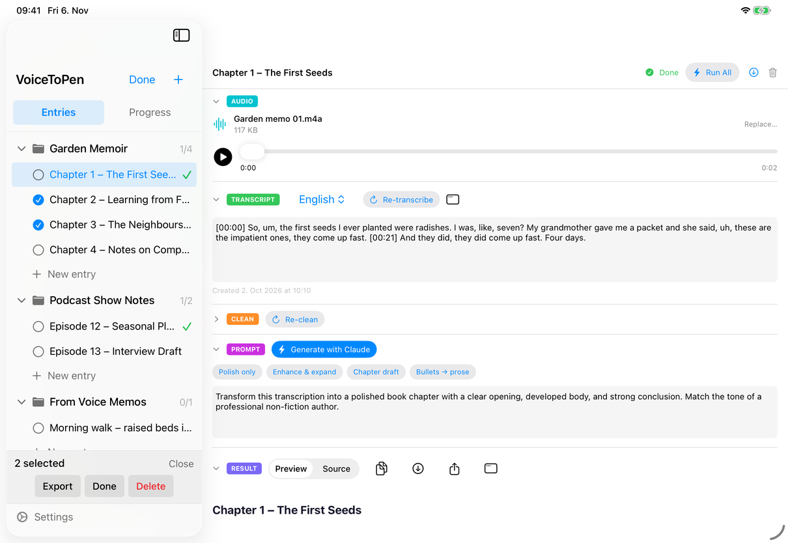
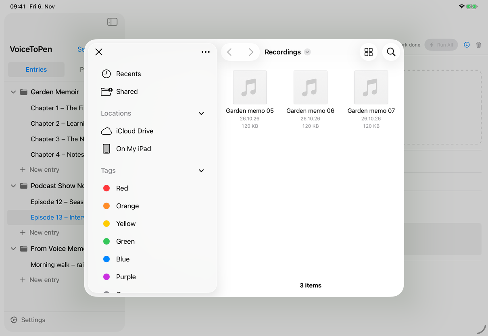

# 10. Using VoiceToPen on iPad

VoiceToPen on iPad works just like on the Mac: the same projects and entries, the same five stages, and the same Run All. The rest of this guide is written for the Mac. This page lists what's different on iPad.

> **iPad version pending:** VoiceToPen for iPad is waiting for App Store approval. Until Apple approves it, VoiceToPen is available for Mac only.

## What you need

- An iPad running **iPadOS 17 or later**
- Your **ElevenLabs** and **Anthropic** API keys — enter them in **Settings** on the iPad too (see [Getting Started](01-getting-started.md#step-4-enter-your-keys-in-voicetopen))

## Touch instead of mouse

| On the Mac you… | On iPad you… |
|---|---|
| **Right-click** a project or entry | **Touch and hold** it to open the same menu (Rename…, Move to project…, Delete and so on) |
| **Hover** over an entry to show its selection circle | Tap **Select** at the top of the sidebar. Circles appear next to every entry; tap entries to select them, then use the bar at the bottom of the sidebar. Tap **Done** when you're finished |
| **Hover** over a project to see how many entries are done | Just look: the count (for example "3/8") is always shown |
| **Double-click** a row in the [Progress view](05-progress-view.md) | **Tap** the row |
| Open a transcript or result **in its own window** | Tap the same **window** icon. The text opens full screen; tap **Done** to go back |

Keyboard shortcuts such as **⌘N** (new entry) work when a hardware keyboard is connected.

## Adding audio

Audio files come from the **Files** app — for example from **On My iPad**, **iCloud Drive** or a connected storage provider:

- Tap **Browse for file…** in the **AUDIO** section and choose the recording, **or**
- With the Files app open next to VoiceToPen (Split View or Stage Manager), **drag** the file onto the dashed **AUDIO** box.

> **Tip:** In the **Voice Memos** app, tap a recording, then **Share → VoiceToPen**. You stay in Voice Memos; the recording lands in the **From Voice Memos** project, and you drag it from there into the project where it belongs — see [Recordings from Voice Memos](03-projects-and-entries.md#recordings-from-voice-memos). If VoiceToPen isn't in the Share menu, tap **More** at the end of the app row.

You can also tap **Record** to record straight into the entry. Keep VoiceToPen on screen while recording: if you switch apps or lock the iPad, the recording stops and is saved — see [Recording in VoiceToPen](04-workflow-stages.md#recording-in-voicetopen).

## Saving exports

When you export (see [Exporting Your Work](06-exporting.md)), iPad shows the **Save** screen of the Files app instead of a Mac save window. Pick a folder and tap **Save**. When exporting several audio files, they are all saved into the folder you pick.

The **Share** icon in the **RESULT** section also offers **Save to Files**, along with your writing, messaging, social and publishing apps. To post straight to Substack Notes, Threads, LinkedIn, Bluesky or Mastodon, see [Post to social networks](04-workflow-stages.md#post-to-social-networks).

## Your data on iPad

- Projects are stored inside the app on the iPad. They're included in your iPad's iCloud or computer backup, but you can't browse them in the Files app — use **Export** to get copies.
- Your Mac and your iPad each keep **their own** projects. They are **not synced** between devices.
- Deleting the VoiceToPen app from the iPad deletes its projects, so export anything you want to keep first.

## Long jobs

Transcribing and generating can take a few minutes for long recordings. Keep VoiceToPen on screen until the job is finished — if you switch to another app for a long time, iPadOS may pause it and the job can fail. If that happens, just run the step again.

**Back to:** [Contents](README.md)
