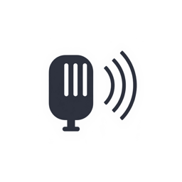
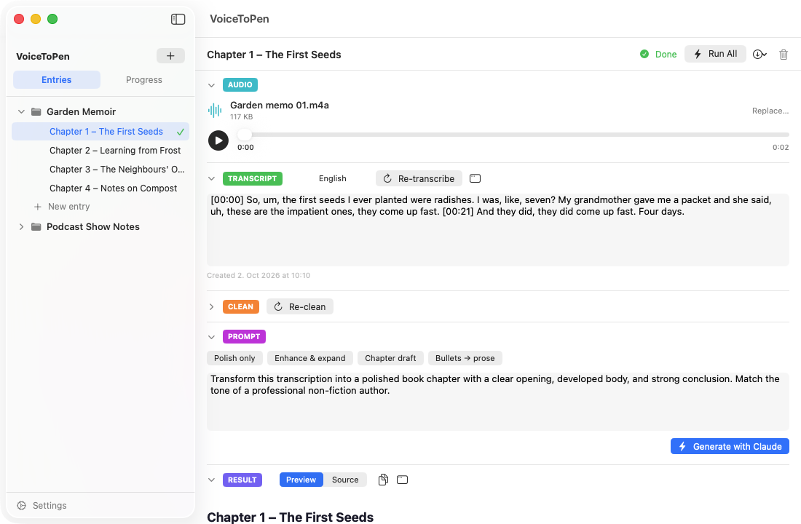

# VoiceToPen User Guide

VoiceToPen turns your voice recordings into polished writing: import audio, get a transcript, clean it up, and let Claude rewrite it into the text you need.

*This guide describes the current App Store version of VoiceToPen, for macOS 14.6 or later. See [Release Notes](release-notes.md) for what's new in each version.*

## Contents

1. [Getting Started](01-getting-started.md) — install the app, get your API keys, enter them in Settings
2. [Quick Start](02-quick-start.md) — from audio to polished text in five minutes
3. [Projects & Entries](03-projects-and-entries.md) — organize your work, bulk actions
4. [The Writing Workflow](04-workflow-stages.md) — Audio, Transcript, Clean, Prompt, Result and Run All in detail
5. [The Progress View](05-progress-view.md) — see the status of every entry at a glance
6. [Exporting Your Work](06-exporting.md) — save text as Markdown and copies of your audio
7. [Privacy & Your Data](07-privacy-and-data.md) — what is sent where, where data is stored, backups
8. [Troubleshooting & FAQ](08-troubleshooting.md) — error messages and common questions
9. [Contact & Support](09-support.md) — how to reach us

Also: [Release Notes](release-notes.md) — what changed in each version

## Keyboard shortcuts

| Shortcut | Action |
|---|---|
| **⌘N** | New entry in the current project |
| **Return** | Confirm a new title or dialog |
| **Esc** | Cancel a dialog |
| **⌘Z** | Undo typing in a text box |
| **⌘Q** | Quit VoiceToPen |

